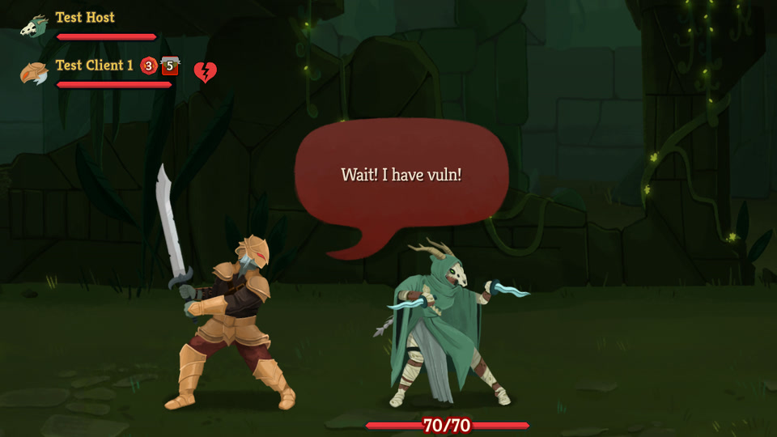
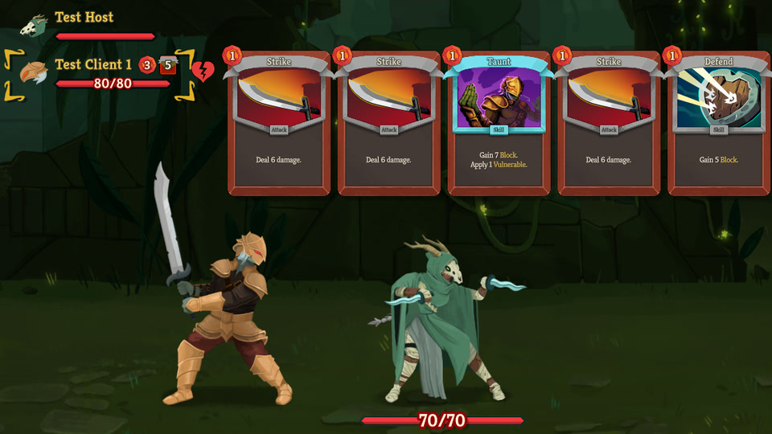

# Wait! I Have Vuln!

A Slay the Spire 2 co-op mod for the moment your teammate swings first while you hold Bash.
It shows who holds a card that applies Vulnerable, so your team applies it before the big hits.
Hover a teammate's card count to see their hand.

**Only the players who want to see it need the mod.** The host does not, and friends without it can still play with you.

**It cannot desync a run.** It only reads the game and never changes it.

**Get it:** [Steam Workshop](https://steamcommunity.com/sharedfiles/filedetails/?id=3831970006) (visible to the author's Steam friends only), or the [latest release](https://github.com/awieczork/sts2-wait-i-have-vuln/releases/latest) to [install by hand](#install).

## What you see

During a co-op combat:

- **Vulnerable icon.** A player's name in the top-left player list gets the Vulnerable icon while they hold a supported card. It is bright when they can play the card, and dimmed when they cannot, such as without the energy.
- **"Wait! I have vuln!"** When a teammate's icon turns bright while an enemy still needs Vulnerable, their character says so in a speech bubble. The first bubble of each combat is always "Wait! I have vuln!"; later ones vary, and some call you by name.
- **Card reminder.** Hover an Attack you can play while a teammate's icon is bright, and a thought cloud beside it reminds you to wait.

  

- **Teammates' reactions.** Play the Attack anyway, and your teammate gets angrier with each one that turn, from "Nooo!" to "I HAD VULN!" to "I'm writing this down."

  

- **Teammate's hand.** Hover the card count next to a teammate's name to see their hand.

  

### Settings

On the main menu, open **Settings > Mod Settings > Wait! I Have Vuln!** and use the mouse. The game locks these settings during a run.

- **Show icon on my own row**
- **Icon size:** 50% to 150%.
- **Teammate hand preview**
- **Show bubbles:** off also hides the thought cloud and the reactions.
- **Card reminder**
- **Varied bubble lines:** off keeps one line for each bubble, "Wait! I have vuln!" or "Nooo!".

### Supported cards

- **Ironclad:** Bash, Break, Dominate, Taunt, Thunderclap, Tremble, Uppercut
- **Silent:** Assassinate, Expose
- **Defect:** Beam Cell
- **Necrobinder:** Fear, High Five, Putrefy
- **Regent:** Comet, Falling Star, Gamma Blast, Know Thy Place, Meteor Shower
- **Colorless and event cards:** Shockwave, Squash, and Mad Science with the Sapping rider from the Tinker Time event

## Good to know

- **Your teammates see it only if they have the mod too.**
- **A dimmed icon still matters.** Your energy card or potion can let that player play the card.
- **Enemies with Artifact get no bubble, cloud, or reaction,** because Vulnerable would only remove the Artifact.
- **The game's own speech bubbles come first,** so a bubble from the mod can wait or be skipped.
- **The bubble text is always English.**
- **The hand preview needs a mouse;** it does not open with a controller.
- **Needs game version 0.107.1 or newer.**
- **Not tested yet:** Mad Science with the Sapping rider, the hand preview's numbers after a teammate's Strength, Weak, or cost changes, using the settings with a controller, macOS, Linux, and Steam Deck.
- **Single-player looks unchanged,** because the game shows the player list only in co-op.

## Install

**Steam Workshop:** subscribe on the [Workshop page](https://steamcommunity.com/sharedfiles/filedetails/?id=3831970006) and start the game.

**By hand:**

1. Download `wait-i-have-vuln-v<version>.zip` from the [latest release](https://github.com/awieczork/sts2-wait-i-have-vuln/releases/latest).
2. Open your game folder: in Steam, right-click Slay the Spire 2 > Manage > Browse local files.
3. Create the folder `mods\WaitIHaveVuln` there, and put `WaitIHaveVuln.dll` and `WaitIHaveVuln.json` from the ZIP into it.

Then start the game, accept the mods warning on the first modded launch, and check that **Wait! I Have Vuln!** is ticked under Settings > Mod Settings.

To remove the mod, unsubscribe on the Workshop or delete the `mods\WaitIHaveVuln` folder.

## Your saves in modded mode

With mods on, the game uses separate modded save profiles, so your unlocks and run history look gone the first time. Your normal saves are untouched and come back when you turn mods off.
To bring your normal progress into the modded profile, follow the [save guide](docs/modded-saves.md).

## Found a bug?

[Open an issue](https://github.com/awieczork/sts2-wait-i-have-vuln/issues) and include the lines containing `[WaitIHaveVuln]` from `%APPDATA%\SlayTheSpire2\logs\godot.log`.

## Building from source

1. Install the .NET 9 SDK and Slay the Spire 2.
2. If the build cannot find the game, copy `Directory.Build.props.example` to `Directory.Build.props` and set `Sts2InstallDir`.
3. Run `dotnet build WaitIHaveVuln.csproj`.
4. Run `dotnet run --project tests/RegressionHarness/WaitIHaveVuln.RegressionHarness.csproj`.

Deployment, testing in local co-op on one PC, and the release checklist are in [CONTRIBUTING.md](CONTRIBUTING.md).

## What's changed

See [CHANGELOG.md](CHANGELOG.md).

## License

[MIT](LICENSE) © Limonene.
Not affiliated with or endorsed by Mega Crit. Slay the Spire 2 and its assets belong to Mega Crit; this repository contains no game files, only screenshots of the game with the mod in use.
