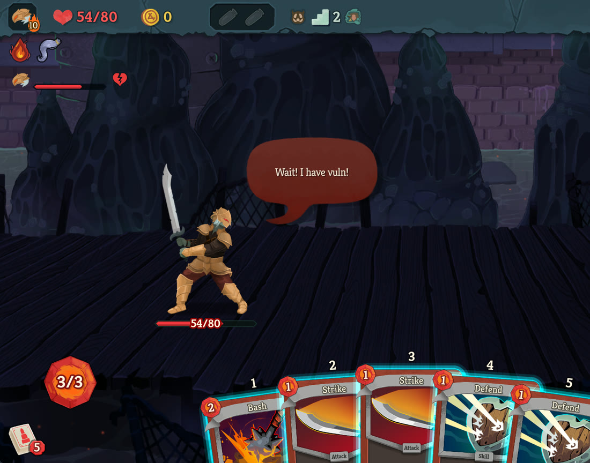
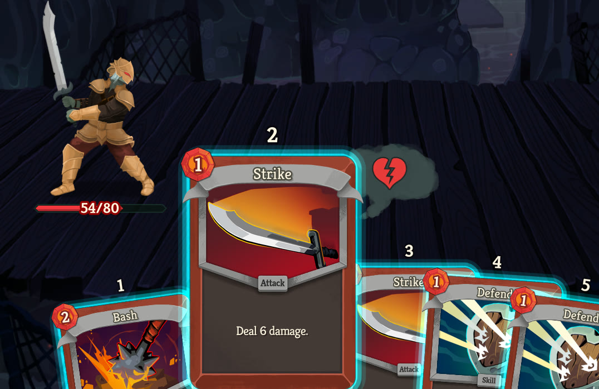
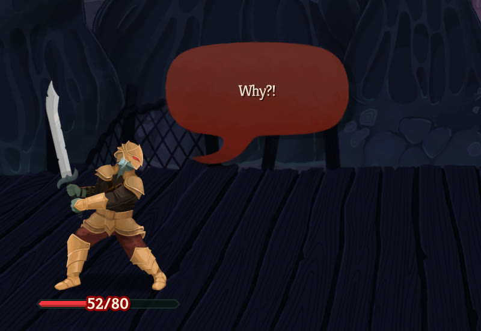
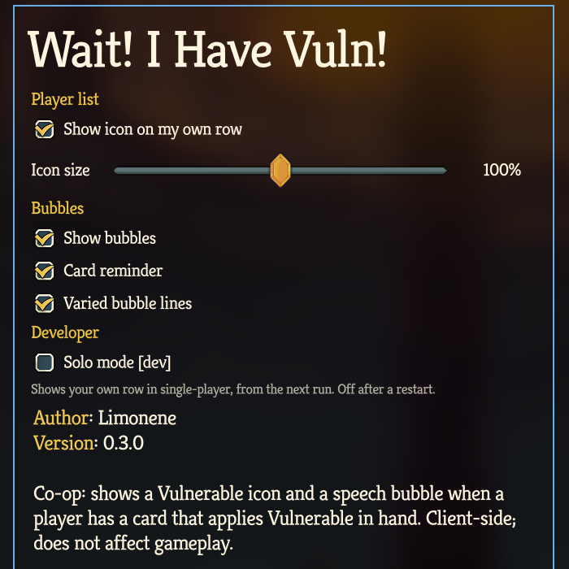

# Wait! I Have Vuln!

A Slay the Spire 2 co-op mod for the moment your teammate swings first while you are holding Bash.
It shows who holds a card that applies Vulnerable, so your team applies it before the big hits.

**Only the players who want to see it need the mod.** The host does not, and friends without it can still play with you.

**It cannot desync a run.** It only reads the game and never changes it.

**Get it:** [Steam Workshop](https://steamcommunity.com/sharedfiles/filedetails/?id=3831970006) (visible to the author's Steam friends only), or the [latest release](https://github.com/awieczork/sts2-wait-i-have-vuln/releases/latest) to [install by hand](#install).

## What you see

During a co-op combat:

- **Vulnerable icon.** The Vulnerable icon appears next to a player's name in the top-left player list while they hold a supported card. Your own row is included.
- **"Wait! I have vuln!"** When a supported card lands in a player's hand, for example when they draw Bash, their character says so in a speech bubble for four seconds, in the character's colour. It shows only while an enemy still lacks Vulnerable and the player has not ended their turn. The first bubble of each combat is always "Wait! I have vuln!"; later ones vary, and some call you by name.
- **Card reminder.** Hover an Attack while a teammate holds a supported card they can play right now, and a thought cloud with the Vulnerable icon appears beside your card. Attacks that apply Vulnerable themselves get no cloud.

  

- **Teammates' reactions.** Play the Attack anyway, and each teammate still holding a supported card reacts over their character. They get angrier with each such Attack in the turn, from "Nooo!" to "I HAD VULN!" to "I'm writing this down."

  

### Settings

Set these on the main menu before you start or continue a run, under **Settings > Mod Settings > Wait! I Have Vuln!**; the game greys out Mod Settings during a run. Use the mouse, because the keyboard cannot reach these settings.

- **Show icon on my own row:** off hides everything on your own row.
- **Icon size:** 50% to 150%.
- **Show bubbles:** off keeps only the icon, with no bubbles, cloud, or reactions.
- **Card reminder:** off turns the thought cloud off.
- **Varied bubble lines:** off keeps every bubble on one fixed line, "Wait! I have vuln!" or "Nooo!".

Your choices are kept for the next game in `%APPDATA%\SlayTheSpire2\WaitIHaveVuln\settings.json`.

### Supported cards

- **Ironclad:** Bash, Break, Dominate, Taunt, Thunderclap, Tremble, Uppercut
- **Silent:** Assassinate, Expose
- **Defect:** Beam Cell
- **Necrobinder:** Fear, High Five, Putrefy
- **Regent:** Comet, Falling Star, Gamma Blast, Know Thy Place, Meteor Shower
- **Colorless and event cards:** Shockwave, Squash

## Good to know

- **Each player sees it on their own screen only.** Your teammates see your icon only if they have the mod too.
- **Mixed groups work.** The mod is marked as not affecting gameplay, so the game lets you join a host whose mods differ and only notes it in the log.
- **The icon means "in hand", not "playable".** It does not check energy. The card reminder and the reactions skip a teammate who cannot play the card right now, for example without the energy, but they cannot know about energy gained later in the turn.
- **After a disconnect,** a player's icon keeps its last state until the mod can see their hand again.
- **The bubble text is always English.**
- **Needs game version 0.107.1 or newer.**
- **Not tested yet:** the card reminder and the reactions with real teammates (tested in solo mode only), hosting with the mod, reconnecting in the middle of a combat, using the settings with a controller, macOS, Linux, and Steam Deck.
- **Single-player looks the same as without the mod.** **Solo mode [dev]** in the settings is a testing aid: it shows your own row in single-player runs from the next run you start or continue, and it turns off when the game restarts.

## Install

**Steam Workshop:** subscribe on the [Workshop page](https://steamcommunity.com/sharedfiles/filedetails/?id=3831970006) and start the game. The item is visible to the author's Steam friends only; everyone else can install by hand.

**By hand:**

1. Download `wait-i-have-vuln-v<version>.zip` from the [latest release](https://github.com/awieczork/sts2-wait-i-have-vuln/releases/latest).
2. Open your game folder: in Steam, right-click Slay the Spire 2 > Manage > Browse local files.
3. Create the folder `mods\WaitIHaveVuln` there, and put `WaitIHaveVuln.dll` and `WaitIHaveVuln.json` from the ZIP into it.

Then start the game, accept the mods warning on the first modded launch, and check that **Wait! I Have Vuln!** is ticked under Settings > Mod Settings.

To remove the mod, unsubscribe on the Workshop or delete the `mods\WaitIHaveVuln` folder.

## Your saves in modded mode

With mods on, the game uses separate modded save profiles, so your unlocks and run history look gone the first time. Your normal saves are untouched and come back when you turn mods off.
To bring your normal progress into the modded profile, follow the [save guide](docs/modded-saves.md).

## Found a bug?

[Open an issue](https://github.com/awieczork/sts2-wait-i-have-vuln/issues) and include the lines containing `[WaitIHaveVuln]` from `%APPDATA%\SlayTheSpire2\logs\godot.log`.

## Building from source

1. Install the .NET 9 SDK and Slay the Spire 2.
2. If the build cannot find the game, copy `Directory.Build.props.example` to `Directory.Build.props` and set `Sts2InstallDir`.
3. Run `dotnet build WaitIHaveVuln.csproj`.
4. Run `dotnet run --project tests/RegressionHarness/WaitIHaveVuln.RegressionHarness.csproj`.

Deployment, testing alone with solo mode, and the release checklist are in [CONTRIBUTING.md](CONTRIBUTING.md).

## What's changed

See [CHANGELOG.md](CHANGELOG.md).

## License

[MIT](LICENSE) © Limonene.
Not affiliated with or endorsed by Mega Crit. Slay the Spire 2 and its assets belong to Mega Crit; this repository contains no game files, only screenshots of the game with the mod in use.
